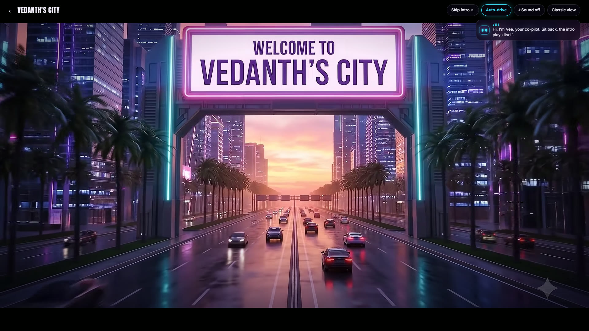
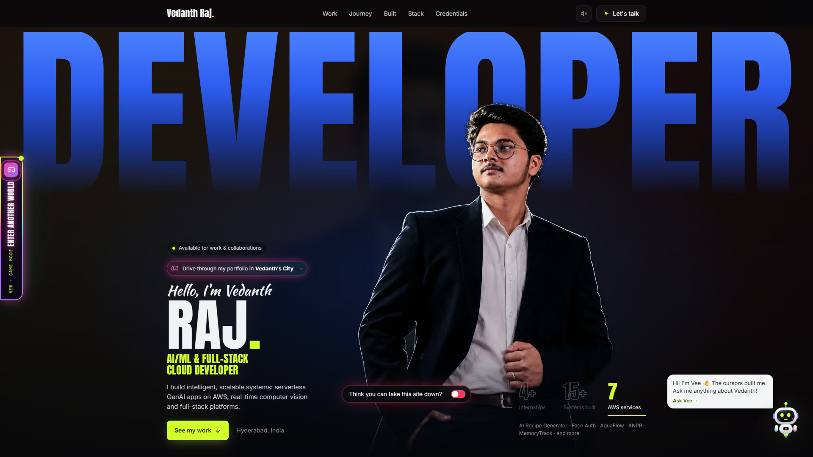
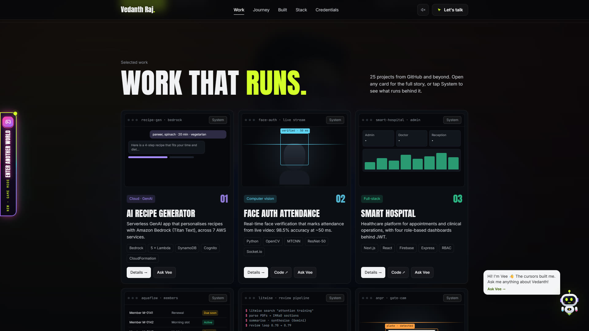
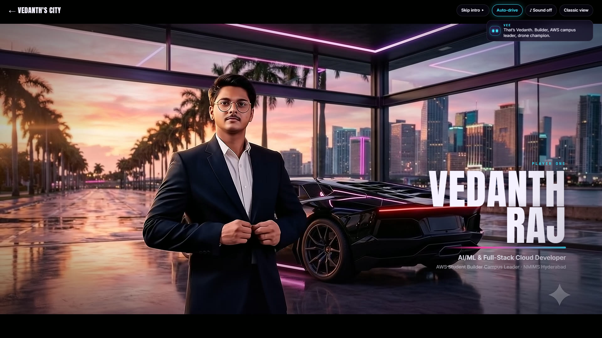
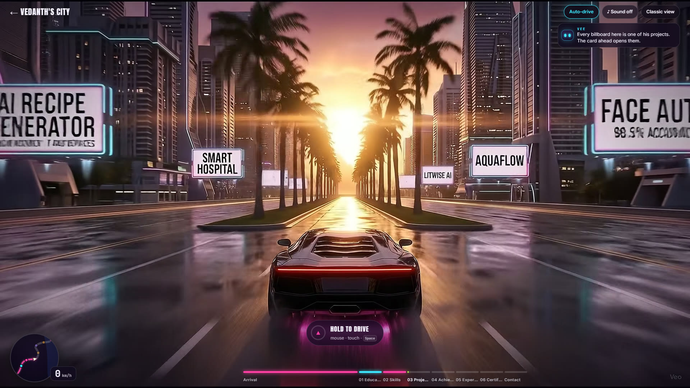
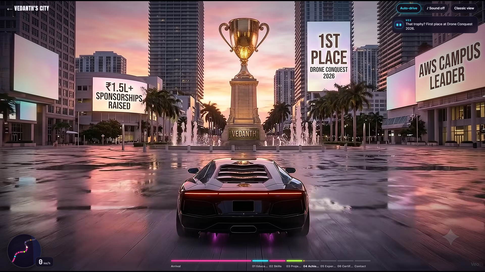
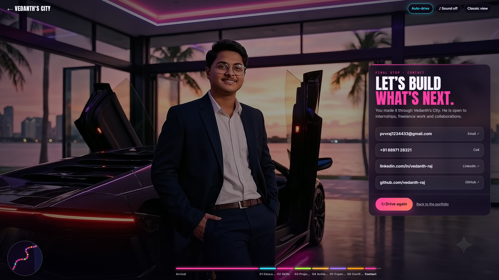

# Vedanth Raj · Portfolio + Vedanth's City

My portfolio, hosted on **AWS Amplify Hosting**, with a game mode: **Vedanth's City**, a cinematic drive through a neon city where every district is a part of my journey.

**Live:** https://portfolio.d26tlmboyckuka.amplifyapp.com
**Game mode:** https://portfolio.d26tlmboyckuka.amplifyapp.com/city.html
**Mirror (Amazon S3 static website):** http://vedanth-raj-portfolio.s3-website-us-east-1.amazonaws.com



---

## What's inside

### The portfolio (`index.html`)
- **About, Skills, Projects, Experience, Credentials and Contact.**
- **Build mode:** the page is "constructed" live by a team of multiplayer-style cursors; when they go idle they assemble into **Vee**, a small robot co-pilot.
- **Vee, the chatbot:** knows my resume, projects and certificates and answers recruiter questions. It runs entirely in the browser (intent matching, fuzzy search and retrieval over `js/knowledge.js`), so it needs no server and never makes things up.
- **Project explorer:** 25 projects with filters, search and a detail drawer (`#project-<id>` deep links).
- **Credentials viewer:** certificates, internship letters and badges with previews and the original PDFs.
- **The creative hint:** a glowing **"Enter another world"** button on the side of every page, plus a chip in the hero, opens Vedanth's City.

### Vedanth's City (`city.html`), the creative feature
A 96-second film in 12 shots that you drive through:

| Shot | What happens |
|---|---|
| 01–04 | Intro cutscene: aerial reveal, the **"Welcome to Vedanth's City"** arch, my character beside the car, taking the wheel |
| 05 | The drive begins |
| 06–11 | Six districts: **Education, Skills, Projects, Achievements, Experience, Certifications**. My details are written on the billboards, pylons, screens and gantries inside the film |
| 12 | Arrival: contact card |

- **Auto-drive** is on by default; press **A** to take the wheel, then **hold** (mouse, touch or Space) to drive and let go to brake.
- Each district ends with a **card** holding the full content (degree and coursework, grouped skills, clickable projects, wins and leadership, the experience timeline, certificates that open the originals).
- Titles and captions are overlays **keyed to film time**, so they move with the camera and freeze when the car stops.
- Minimap, speedometer, district rail and chapter deep links (`city.html#projects`).

## How it was made

1. **Footage:** every shot was generated with **Google Flow**: stills with **Nano Banana** (my own photos as the character reference, and my details rendered on the signs), animated with **Veo 3.1**, then upscaled to **1080p** in Flow. For the shots with my face, each clip is anchored on a checked start *and* end frame so the face stays consistent.
2. **Encoding:** three cuts with FFmpeg: **1080p AV1** (for devices with hardware AV1 decoding), **1080p H.264** (fallback) and **720p H.264** (phones). The page picks one with `MediaCapabilities`.
3. **Playback:** the whole film is downloaded before the drive starts (with a percentage loader), then played from memory through two double-buffered `<video>` elements, so there's no streaming or stutter mid-drive. Braking eases the playback rate from 1× to about 0.5× before stopping on a frame, instead of crawling in slow motion.

## AWS

| Service | Use |
|---|---|
| **AWS Amplify Hosting** | Production hosting (HTTPS, global CDN). Built with Vite and deployed as a manual deployment to the `portfolio` branch |
| **Amazon S3** | Static-website mirror of the same build (`vedanth-raj-portfolio`, us-east-1), public-read bucket policy in `s3-policy.json` |

Deploying:

```bash
npm ci && npm run build
# Amplify: zip dist/ → aws amplify create-deployment → upload → aws amplify start-deployment
# S3:      aws s3 sync dist s3://vedanth-raj-portfolio --delete
```

## Run it locally

```bash
npm install
npm run dev        # http://localhost:5173  (game mode: /city.html)
```

The game-mode clips are not in this repo (about 270 MB). To run the city locally, download them from the live site into `public/city/{av1,hd,m}/01.mp4 … 12.mp4`.

## Project structure

```
index.html, main.js, style.css, explore.css, robot.css   the portfolio
city.html, city.css, js/city/main.js                     Vedanth's City
js/knowledge.js, js/catalog.js, js/creds-data.js          all the content (single source of truth)
js/chat-brain.js, js/robot.js                             Vee, the in-browser chatbot
js/build.js, js/background.js, js/explorer.js, js/creds.js, js/portal.js
public/                                                   images, credentials, posters
docs/screenshots/                                         screenshots
```

## Screenshots

| | |
|---|---|
|  |  |
|  |  |
|  |  |

More in [`docs/screenshots`](docs/screenshots).

---

© 2026 Vedanth Raj (P V V Raj) · [LinkedIn](https://linkedin.com/in/vedanth-raj) · [GitHub](https://github.com/vedanth-raj)
